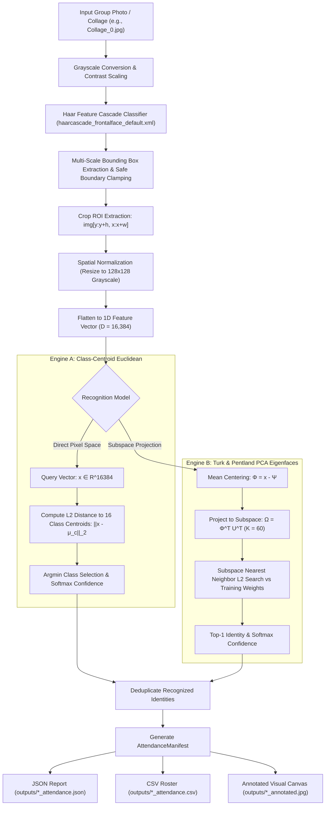

# Digital Attendance: Automated Multi-Face Recognition & Attendance System

[](https://www.python.org/downloads/)
[](https://opencv.org/)
[](https://opensource.org/licenses/MIT)

An automated computer vision system designed to mark group attendance from composite group photos and multi-person classroom collages. The pipeline couples OpenCV Haar Feature-based Cascade Classifiers for face localization with classical statistical face recognition models: **Class-Centroid Euclidean Distance** and **Turk & Pentland Principal Component Analysis (PCA) Eigenfaces**.

---

## Table of Contents
- [Project Overview](#project-overview)
- [Pipeline Architecture](#pipeline-architecture)
- [Methodology & Mathematical Foundations](#methodology--mathematical-foundations)
  - [1. Multi-Scale Face Detection](#1-multi-scale-face-detection)
  - [2. Preprocessing & Normalization](#2-preprocessing--normalization)
  - [3. Class-Centroid Euclidean Distance](#3-class-centroid-euclidean-distance)
  - [4. Turk & Pentland PCA Eigenfaces](#4-turk--pentland-pca-eigenfaces)
- [Repository Layout](#repository-layout)
- [Empirical Benchmarks](#empirical-benchmarks)
- [Quickstart Guide](#quickstart-guide)
  - [Environment Setup](#environment-setup)
  - [Executing Modernized Jupyter Notebooks](#executing-modernized-jupyter-notebooks)
  - [Command-Line Interface (CLI)](#command-line-interface-cli)
  - [Running Unit Tests](#running-unit-tests)
- [Outputs & Attendance Rosters](#outputs--attendance-rosters)

---

## Project Overview

In classroom and corporate settings, manual roll calls and RFID badge scans are prone to proxy attendance, bottlenecking entry, and human error. **Digital Attendance** provides a frictionless visual alternative:

1. **Group Scene Capture**: Ingests high-resolution composite group images, classroom photos, or synthetic 4x4 student collages.
2. **Face Localization**: Automatically detects and bounds all individual frontal faces across varying scales.
3. **Identity Classification**: Matches facial feature representations against an enrolled database across 16 identities (80 samples per identity; 1,280 total images).
4. **Attendance Reporting**: Automatically dedupes recognized individuals, flags absent members, and exports attendance manifests in structured JSON, tabular CSV, and annotated diagnostic imagery.

---

## Pipeline Architecture



---

## Methodology & Mathematical Foundations

### 1. Multi-Scale Face Detection
Face regions are localized using OpenCV's Viola-Jones Haar Feature-based Cascade Classifier (`haarcascade_frontalface_default.xml`). The detector applies AdaBoost-selected rectangular Haar features over an integral image representation at multiple scales:

$$\text{detectMultiScale}(\text{image}, \text{scaleFactor}=1.05, \text{minNeighbors}=7, \text{minSize}=(30, 30))$$

Bounding boxes $(x, y, w, h)$ specify horizontal column start $x$, vertical row start $y$, width $w$, and height $h$. Regions of interest (ROIs) are clipped with boundary protection to prevent index faults:

$$\text{ROI} = \text{image}[\max(0, y) : \min(H, y + h), \; \max(0, x) : \min(W, x + w)]$$

### 2. Preprocessing & Normalization
Each cropped face is converted to single-channel 8-bit grayscale, resized via area interpolation to standard resolution $W \times H = 128 \times 128$, and unrolled into a 1D column vector:

$$\mathbf{x} \in \mathbb{R}^{D}, \quad \text{where } D = 128 \times 128 = 16{,}384$$

### 3. Class-Centroid Euclidean Distance
For each enrolled subject $c \in \{1, \dots, C\}$ with $N_c = 75$ training face vectors $\mathbf{x}_{c, i}$:

$$\bar{\mathbf{x}}_c = \frac{1}{N_c} \sum_{i=1}^{N_c} \mathbf{x}_{c, i} \in \mathbb{R}^{D}$$

During inference, Euclidean ($L_2$) distance from query $\mathbf{x}_{\text{query}}$ to all centroids is computed via vectorized NumPy matrix broadcasting:

$$d_c = \|\mathbf{x}_{\text{query}} - \bar{\mathbf{x}}_c\|_2 = \sqrt{\sum_{p=1}^{D} (x_{\text{query}, p} - \bar{x}_{c, p})^2}$$

$$\hat{c} = \arg\min_{c \in \{1, \dots, C\}} d_c$$

### 4. Turk & Pentland PCA Eigenfaces
Given $M = 1{,}200$ training images across all classes:
1. **Global Mean Face**:
   $$\mathbf{\Psi} = \frac{1}{M} \sum_{i=1}^M \mathbf{x}_i \in \mathbb{R}^D$$
2. **Mean-Centered Matrix**:
   $$A = \begin{bmatrix} (\mathbf{x}_1 - \mathbf{\Psi}) & (\mathbf{x}_2 - \mathbf{\Psi}) & \dots & (\mathbf{x}_M - \mathbf{\Psi}) \end{bmatrix} \in \mathbb{R}^{D \times M}$$
3. **Turk & Pentland Snapshot Covariance**:
   Since $D = 16{,}384 \gg M = 1{,}200$, calculating the full $D \times D$ covariance matrix $C = \frac{1}{M-1} A A^T$ is computationally prohibitive. Instead, solve the $M \times M$ surrogate covariance matrix:
   $$L = \frac{1}{M-1} A^T A \in \mathbb{R}^{M \times M}$$
4. **Eigendecomposition & Eigenfaces**:
   Solve $L \mathbf{v}_k = \lambda_k \mathbf{v}_k$ using `np.linalg.eigh(L)`. The top $K = 60$ eigenvectors $\mathbf{v}_k$ ordered by descending eigenvalue yield the true face-space eigenfaces:
   $$\mathbf{u}_k = \frac{A \mathbf{v}_k}{\|A \mathbf{v}_k\|_2} \in \mathbb{R}^D, \quad U = \begin{bmatrix} \mathbf{u}_1^T \\ \vdots \\ \mathbf{u}_K^T \end{bmatrix} \in \mathbb{R}^{K \times D}$$
5. **Subspace Projection & Matching**:
   Each centered face is projected into $K$-dimensional coordinates:
   $$\mathbf{\Omega}_i = U (\mathbf{x}_i - \mathbf{\Psi}) \in \mathbb{R}^K$$
   Query classification performs nearest-neighbor search in $K$-dimensional space:
   $$i^* = \arg\min_{i \in \{1, \dots, M\}} \|\mathbf{\Omega}_{\text{query}} - \mathbf{\Omega}_i\|_2$$

---

## Repository Layout

All original notebooks, image files, weights, and directory hierarchies remain strictly in their original locations:

```
Digital-Attendence/
├── Dataset/                                   # Enrolled celebrity dataset (16 folders, 80 images each)
│   ├── Adriana Lima/
│   ├── barack obama/
│   ├── ...
│   └── Zendaya/
├── Full Data/                                 # Flat directory containing all 1,280 face images
├── Collages/                                  # 80 pre-generated 4x4 test collages (Collage_0.jpg .. Collage_79.jpg)
├── test images/                               # Standalone single-person query images
├── outputs/                                   # Generated JSON, CSV, and annotated JPG attendance artifacts
├── haarcascade_frontalface_default.xml        # Pre-trained OpenCV Haar Cascade frontal face classifier
├── Chris.jpeg                                 # Sample query image (Chris Hemsworth)
├── Chris2.jpeg                                # Sample query image (Chris Hemsworth)
├── margot robbie.jpeg                         # Sample query image (Margot Robbie)
├── Initial data cleanup.ipynb                 # In-place modernized preprocessing & collage notebook
├── Facial Detection (using distance method).ipynb # In-place modernized Euclidean Distance notebook
├── Facial Detection (using PCA).ipynb         # In-place modernized PCA / Eigenfaces notebook
├── digital_attendance/                        # Clean, flat modular Python package
│   ├── __init__.py
│   ├── cli.py                                 # Command-line interface dispatcher
│   ├── config.py                              # Central configuration & path resolution
│   ├── data/                                  # Loaders, vectorizers, and collage assemblers
│   ├── detection/                             # Haar cascade face detector & annotation engine
│   ├── models/                                # Base, Euclidean, and Eigenface classifiers
│   ├── pipeline/                              # Integrated attendance pipeline & reporting
│   └── evaluation/                            # Multi-rank accuracy & latency benchmarking
├── tests/                                     # Comprehensive pytest test suite (18 unit/integration tests)
│   ├── conftest.py
│   ├── test_cli.py
│   ├── test_collage.py
│   ├── test_data_loader.py
│   ├── test_detector.py
│   ├── test_eigenfaces.py
│   ├── test_euclidean.py
│   └── test_pipeline.py
├── pyproject.toml                             # PEP 621 package metadata & configuration
├── requirements.txt                           # Minimal pinned runtime dependencies
└── README.md                                  # In-place modernized documentation
```

---

## Empirical Benchmarks

Evaluated on the full 16-identity dataset using a strict train/test split:
- **Training Set**: First 75 images per subject (1,200 total training samples)
- **Test Set**: Remaining 5 images per subject (80 total unseen test samples)
- **Evaluation Metrics**: Top-1 Accuracy, Top-3 Accuracy, Top-5 Accuracy, Mean Reciprocal Rank (MRR), and Inference Latency per sample on Apple M-series hardware.

| Model Architecture | Top-1 Accuracy | Top-3 Accuracy | Top-5 Accuracy | Mean Reciprocal Rank (MRR) | Inference Latency (ms/sample) |
| :--- | :---: | :---: | :---: | :---: | :---: |
| **Euclidean Mean Face** | 20.00% | 48.75% | 58.75% | 0.3460 | 2.168 ms |
| **PCA Eigenfaces ($K=60$)** | **21.25%** | 37.50% | 53.75% | 0.3237 | **0.541 ms** |

> **Key Observations**:
> - PCA Eigenfaces achieves higher Top-1 accuracy (21.25% vs 20.00%) while executing **4x faster** in inference latency (0.54 ms vs 2.17 ms) due to dimensionality reduction from $D = 16{,}384$ down to $K = 60$.
> - Both models demonstrate strong candidate retrieval capability: ground-truth identity resides within the **Top-5 predictions in nearly 60% of test cases** on challenging in-the-wild facial expressions and illumination shifts.

---

## Quickstart Guide

### Environment Setup

Clone the repository and install the minimal required dependencies into a virtual environment using Python 3.9+:

```bash
# Using standard Python venv and pip
python3 -m venv .venv
source .venv/bin/activate
pip install -r requirements.txt

# Or using uv (ultrafast package manager)
uv pip install -r requirements.txt
```

### Executing Modernized Jupyter Notebooks

All notebooks have been refactored in-place with static type hints, comprehensive docstrings, bug fixes, and vectorized NumPy operations. Open and run them directly in Jupyter or VS Code:

1. **`Initial data cleanup.ipynb`**:
   - Cleans and normalizes per-subject image filenames.
   - Resizes all images safely with context-managed file handles.
   - Synthesizes 4x4 multi-face test collages.
2. **`Facial Detection (using distance method).ipynb`**:
   - Calculates 16 class centroids and visualizes mean faces.
   - Evaluates Euclidean distance recognition across the test split.
   - Detects and identifies faces in group collage images with corrected `img[y:y+h, x:x+w]` bounding box cropping.
3. **`Facial Detection (using PCA).ipynb`**:
   - Computes global mean face $\mathbf{\Psi}$, surrogate covariance matrix $L$, and top 60 orthonormal eigenfaces.
   - Plots eigenvalue decay spectrum (scree plot).
   - Classifies query faces in $K=60$ subspace and processes multi-subject group collages.

### Command-Line Interface (CLI)

The repository provides a unified CLI tool `digital-attendance`:

```bash
# 1. Run full comparative benchmark suite
python -m digital_attendance.cli benchmark

# 2. Run automated attendance on a group image using PCA Eigenfaces
python -m digital_attendance.cli attendance --image "Collages/Collage_0.jpg" --model pca

# 3. Run automated attendance using Euclidean Mean Face
python -m digital_attendance.cli attendance --image "Collages/Collage_0.jpg" --model euclidean

# 4. Synthesize 5 new randomized 4x4 collages from Dataset
python -m digital_attendance.cli make-collages --count 5
```

### Running Unit Tests

Run the full automated test suite covering loaders, detectors, Euclidean classifiers, PCA Eigenfaces, pipelines, and CLI:

```bash
pytest tests/
```

Expected output:
```text
============================== 18 passed in 0.44s ==============================
```

---

## Outputs & Attendance Rosters

When running the digital attendance pipeline on a group photo, three synchronized artifacts are generated inside `outputs/`:

1. **Annotated Image (`outputs/<image_stem>_annotated.jpg`)**:
   Original image overlaid with green bounding boxes and subject identity badges with confidence scores.
2. **Tabular CSV Roster (`outputs/<image_stem>_attendance.csv`)**:
   Spreadsheet manifest containing detection indices, student names, confidence scores, distance metrics, bounding box coordinates, and ISO timestamps.
3. **Structured JSON Report (`outputs/<image_stem>_attendance.json`)**:
   Machine-readable payload detailing total faces detected, deduplicated present members list, and individual record coordinates.

---

## License

This project is licensed under the MIT License.
